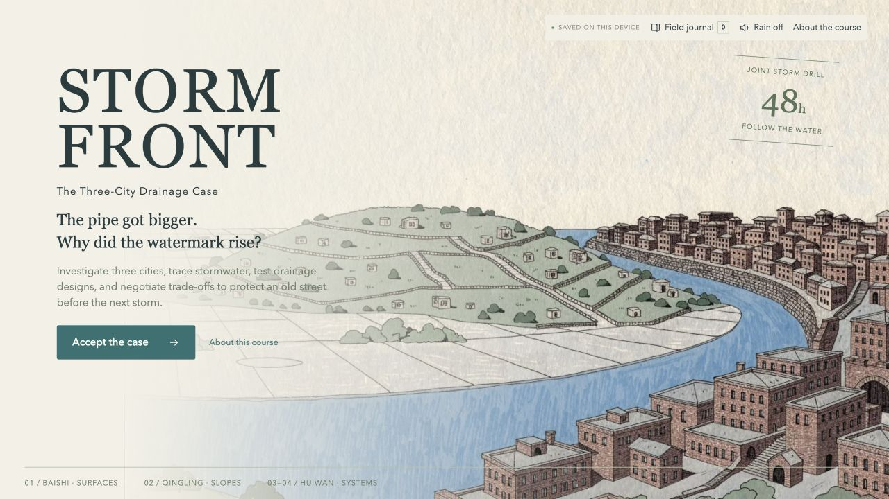

# Stormfront: The Three-City Drainage Case

**[Play the game](https://matcharobot.github.io/stormfront-stem-game/)** · [Quick walkthrough](#quick-walkthrough-spoilers) · [Learning design](#learning-design) · [Verification](VALIDATION.md)

> Investigate three cities, trace stormwater, test drainage designs, and negotiate trade-offs to protect an old street before the next storm.

An English STEM investigation and engineering simulation for lower-secondary learners and above, created for **IDAT7220**. The primary STEM branch is **Environmental / Civil Engineering**, integrating science, technology and mathematics. It uses Twine / SugarCube, illustrated evidence, interactive experiments and a simplified stormwater model.

No account or installation is required to play. Use a desktop or laptop in landscape orientation. The game keeps a fixed **16:9** frame and advances through screens rather than a scrolling webpage. Rain audio is optional and starts off.

## What is the game about?

A larger drainage pipe passed its acceptance test, yet an old street flooded again. As a catchment investigator, the player follows the water from a paved town through a hillside tributary into a mixed urban catchment. Decisions about surfaces, facility placement, flow timing, storage, outlet allocation and community use affect the final storm drill.

The central question is: **why can a locally improved system still fail downstream?** Players must explain the result using evidence, rather than judging safety from pipe size alone.

## What is included?

| Part | Place and challenge | What the player does |
| --- | --- | --- |
| Prologue | Huiwan Old Street: two conflicting watermarks | Record an initial hypothesis without penalty. |
| Chapter 1 | **Baishi — flat ground and changing surfaces** | Compare grass and asphalt under equal rainfall, explain runoff and choose a response. |
| Chapter 2 | **Qingling — hillside routes and delayed arrival** | Inspect elevation, tracer or camera evidence; choose a facility and put it on the actual flow path. |
| Chapter 3 | **Huiwan fringe — tributaries meet** | Hear community priorities, choose a shared-budget proposal, then record a designer's reason, an evidence checker's concern and a joint response. |
| Chapter 4 | **Huiwan centre — a constrained river outlet** | Diagnose the boundary condition, revise the design and retest at high river level. |
| Learning review | A supported recommendation | Complete four questions with feedback and an evidence-based case statement before closing the case. |
| Ending and report | Five possible engineering outcomes | Read the outcome, revisit a design or export a text report of decisions, evidence, simulation data and learning records. |

**Field journal** reopens collected records. **About the course** contains the topic, STEM branch, four objectives, concrete learning-strategy applications and image attribution. Both are accessible from the in-scene controls.

Choices reconverge at shared review points, while their effects persist in the water profiles, budget and ending. The five endings cover both districts open, opening supported by pitch storage, either of two partial openings, and delayed opening. Completing the learning review is separate from achieving a successful engineering outcome.

## Quick walkthrough (spoilers)

This reviewer route demonstrates all four chapters and reaches **Both lights return**. It is one valid route, not the only solution. The sample entries below are demonstration responses; learners should write their own reasoning.

### 1. Start and investigate Baishi

1. Open **About this course** if desired, then **Return to game** and **Accept the case**. For an existing save, use **Start a new case** only if you want to replace that browser's progress.
2. Choose any first hypothesis, then **Travel to Baishi**.
3. Open **Grass became a car park**, return with **Continue investigating**, then choose **Run a controlled experiment**.
4. Leave rainfall at **30 mm**, click **Run the experiment**, then **Explain the result**. Select **“Different surfaces change the proportion that becomes runoff.”**
5. Click **Design a response**. Choose **Let the ground absorb more / Replace paving**, run the storm test and **Travel to Qingling**.

### 2. Trace Qingling's delayed flow

1. Open **Ten minutes later** and compare **14:20 / arriving** with **14:30 / rising**. Return and choose **Explain the delayed flow**.
2. Select **“Runoff already generated keeps travelling downhill after rain stops.”** Then **Design a response**.
3. Choose **Catch it on the slope / Intercept & infiltrate**, place it **On the main gully**, run the test and **Travel to Huiwan**.

### 3. Review the shared proposal

1. Inspect at least one community record, such as **A temporary pitch agreement**. Return, choose **Choose a shared design**, then **Invest further upstream / Intercept & infiltrate**. This spends **8 of the 12 shared credits**.
2. Run the test and click **Review this proposal**. For individual review, choose **Solo self-review**. For a pair, choose **Two learners** and pass the controls between roles.
3. Enter the following designer reason, then **Pass to the evidence checker**:

   > We intercept runoff upstream to reduce the combined inflow before it reaches the constrained city outlet.

4. Select **Combined peak — 28.7 m³ / round**, and enter a concern:

   > Will this proposal still protect both districts when a higher river level reduces the outlet capacity?

5. Click **Discuss a joint response**. Enter an agreement, then **Agree & travel to the centre**:

   > Keep the upstream proposal and test both districts under the current high river level before recommending opening.

### 4. Retest under the current condition

1. Select **Compare the test conditions**. The outlet limit changes from **32 to 16 m³ per ten-minute round**, while the storm and design stay fixed.
2. Choose **Make the final adjustment**. Keep **Test the existing system** and **Balanced / 55:45**, then **Retest at high river level**.
3. Expected result for this exact route: **95.4 m³ total inflow**, **0 m³ overflow in both districts**, and **4 shared credits remaining**. These are fictional classroom values.
4. Optional: compare the old low-river test and inspect **Round-by-round data**, then return to today's result. Click **Submit for learning review**.

### 5. Complete the learning record and reveal the ending

Select the following knowledge responses, using **Next question** after each:

| Question topic | Supported response |
| --- | --- |
| Fair surface comparison | Same rain, area and duration; change only the surface. |
| A faster bypass | Check whether its peak overlaps another flow downstream. |
| Water remaining in a tank | Water still stored, needing a later drainage plan. |
| Transfer to another city | Check upstream runoff, arrival timing and downstream water level. |

Continue to the case statement:

1. Select the **connected path** beginning **“Upstream surfaces → hillside tributary…”** and attach **Total inflow — 95.4 m³**.
2. Click **Write the explanation**. A demonstration explanation is:

   > Permeable paving and upstream interception reduced total inflow to 95.4 cubic metres before the constrained city outlet, keeping both districts within the overflow target.

3. Add a follow-up responsibility:

   > Reserve the four remaining credits for inspections and maintenance, and monitor the outlet before the next storm.

4. **Record the case statement**. The checklist should show **3/3 learning records complete** and both earlier explanations checked. Its main button guides you to anything still missing.
5. Click **Close the case & reveal the ending** to see **Both lights return**. **Export case report** saves the evidence and responses as a text file.

### Optional branch to demonstrate a different trade-off

In a new case, choose **Widen the inlet** in Baishi, **30 m³ foothill storage** **On the main gully** in Qingling, and **Distribute small tanks** at the fringe. Visit **A temporary pitch agreement**. Complete the role review, then at the final design check **Commit to pitch restoration**, choose **Activate the community pitch**, and keep **Balanced** allocation. Both districts pass with **64 m³ held in the pitch** and **6 shared credits remaining**. Complete the same learning-review process using that route's actual data. This produces **The pitch buys one night**, with a postponed match and a restoration responsibility.

## Learning design

### Objectives and alignment

By the end, learners should be able to:

1. Use a fair comparison to explain surface runoff.
2. Trace connected flow paths and overlapping arrival times.
3. Design and retest within a 12-credit shared budget.
4. Justify a trade-off using a system path, actual data and a follow-up responsibility.

**Scenario-Based Learning** supplies the sustained mystery, stakeholder perspectives and consequential decisions. The **5E inquiry model** structures the activities:

| Phase | Application in the game |
| --- | --- |
| Engage | Predict an explanation for the higher watermark after the pipe upgrade. |
| Explore | Hold rain, sample area and duration constant while comparing surfaces; inspect maps and camera records. |
| Explain | Use observed runoff and arrival times; revise unsupported explanations using feedback. |
| Elaborate | Transfer principles to connected cities and negotiate a shared-budget design through two perspectives. |
| Evaluate | Retest at high river level, complete a transfer check and justify a recommendation with actual simulation evidence. |

Factual learning is supported by records and quantities; conceptual learning by runoff and outlet comparisons; procedural learning by controlled testing and retesting; problem-solving by placement, budgeting and collaborative review.

### Assessment and facilitation

The game supports shared-device pair work and explicitly labelled solo self-review. A facilitator can ask learners to compare their initial hypothesis with their final evidence, challenge an allocation choice, or explain who bears a remaining cost.

Knowledge feedback supports revision. Written-entry checks verify **completeness**, not scientific quality; the latter remains for teacher or peer review. A failed engineering drill can still produce a complete, well-supported learning record. Changing the design or test requires relevant records to be confirmed again.

## Files and technology

- **[index.html](index.html)** — self-contained playable game, including all 18 illustrations and the runtime; also works when downloaded and opened locally.
- **[Stormfront.twee](Stormfront.twee)** — full editable Twine/Twee story source, script and styles.
- **[SOURCE.zip](SOURCE.zip)** — modular source, build script, tests, media and runtime licence. Extract and read `DEVELOPMENT.md` to rebuild or serve `dist/` locally.
- **[VALIDATION.md](VALIDATION.md)** — release checks and model boundaries.
- **[SUGARCUBE-LICENSE.txt](SUGARCUBE-LICENSE.txt)** — licence for the bundled third-party story runtime.

The game uses SugarCube state and passage events, saved choices, interactive forms, a ten-round water-balance simulation, SVG flow overlays/charts, synthesized rain audio and local text export. No external runtime libraries or analytics are fetched. Progress is saved locally in the current browser; the hosted and downloaded copies have separate saves. Written responses are not sent to a game server.

## Credits and boundaries

Story, activities and teaching model were tailored to this project with AI assistance. **All 18 illustrations were generated and edited with Recraft**. Rain audio is synthesized in the browser. The camera image is an illustration with teaching overlays, not measured flood footage. SugarCube is by Thomas Michael Edwards; its licence is retained.

Learning-design references: course materials **SS03.6 Scenario-based Learning** and **SS04.2 5E Model**. Contextual reference: [Hong Kong Drainage Services Department — Flood Prevention Strategy](https://www.dsd.gov.hk/others/IRTS/en/fpwc.html).

All cities, runoff profiles, costs and opening thresholds are fictional classroom settings. Stored water still requires later drainage. The model illustrates runoff, timing, storage and outlet constraints; it is not a real flood forecast or engineering design standard. Designs are not intended to be equally effective: some choices deliberately expose the consequences of treating a local improvement as a catchment-wide solution.
